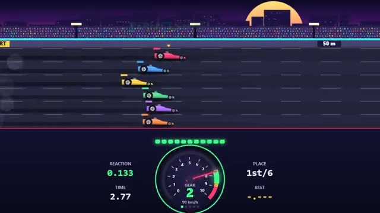

# Drag Tap

Launch on green. Shift on green. Ten seconds. A multiplayer starter game from [Multiplayer Agent](https://multiplayeragent.com): 2D, versus, 2–6 players, with bots that fill empty lanes.

## How it plays

Up to six cars line up. Tap on green to launch, then tap each time the rev needle hits the green zone to shift up. Perfect shifts give a kick, early ones bog down, late ones bounce off the limiter. Best time wins.

**Controls:** Space, Enter or click to launch and shift; on phones, tap the big button.

## Make it yours in the Game Builder

Open the [Game Builder](https://multiplayeragent.com), choose **Start from a starter game** and pick Drag Tap. It opens as version 1 in your studio, ready to play and publish. Then ask for changes, for example:

- Add a nitro button you can use once per race
- Let players pick their car's color and number before the race
- Make it a night race on a rainy strip with slippery launches

## Run it yourself

1. Get a free publishable key (`pk_…`) at [multiplayeragent.com](https://multiplayeragent.com).
2. In `index.html`, put it in place of `pk_REPLACE_ME` in the `MP_CONNECT` block.
3. Open `index.html` in a browser. No build step and no server needed.

Without a key it still runs, offline against bots.

## How it is built

- One `index.html`. The comment at the top of the script maps the code and explains the multiplayer. The gearbox, the engine and the green zone are plain numbers in `CONFIG`.
- **Leaderboard:** Each player's fastest run.
- **Host-run rounds:** One player's browser lights the tree, sets the lanes and posts the results; if it leaves, the next player takes over.
- **Bots:** Bot drivers with their own reactions and shifting fill the empty lanes.
- **Live sync:** Every car moves for everyone as its driver launches and shifts.
- `?attract` runs it offline: your car drives itself against bots on a shorter strip. The preview video is recorded from it.

## License

MIT.
